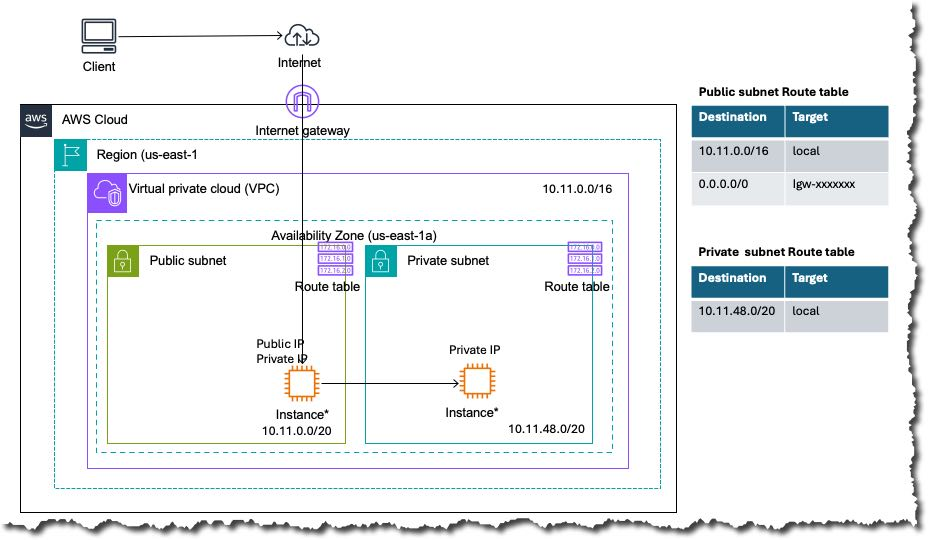

# AWS Networking Lab 02:  VPC with Public and Private Subnets

<!-- Row 1: Status - Most Important -->
[](https://github.com/subhamay-bhattacharyya/aws-lab02-private-subnet-ec2-access/releases)&nbsp;[](https://github.com/subhamay-bhattacharyya/aws-lab02-private-subnet-ec2-access/actions/workflows/release.yaml)&nbsp;[](https://github.com/subhamay-bhattacharyya/aws-lab02-private-subnet-ec2-access/issues)&nbsp;[](https://github.com/subhamay-bhattacharyya/aws-lab02-private-subnet-ec2-access/commits)

<!-- Row 2: Code Quality -->
[](https://github.com/subhamay-bhattacharyya/aws-lab02-private-subnet-ec2-access)&nbsp;[](https://github.com/subhamay-bhattacharyya/aws-lab02-private-subnet-ec2-access/commits)

<!-- Row 3: Tech Stack -->
[](https://aws.amazon.com/cloudformation/)&nbsp;[](https://claude.ai/)

<!-- Row 4: Repository Info -->
[](https://github.com/subhamay-bhattacharyya/aws-lab02-private-subnet-ec2-access)&nbsp;[](https://github.com/subhamay-bhattacharyya/aws-lab02-private-subnet-ec2-access)&nbsp;[](https://github.com/subhamay-bhattacharyya/aws-lab02-private-subnet-ec2-access/releases)

<!-- Row 5: Custom Metrics -->
[](https://gist.github.com/subhamay-bhattacharyya/7fe6027c609d7c63549460bc7d6625ba)

## Overview

This lab builds a VPC with a public subnet and a private subnet, plus SSH security groups and one EC2 instance in each subnet. The public instance is reachable over SSH from the internet. The private instance accepts SSH only from the public SSH security group, so you reach it through the public instance.

## Architecture Diagram



The diagram shows EC2 instances in both subnets, the Internet gateway, and the route table for each subnet. It does not show the security groups.

---

This lab deploys a VPC with one public subnet and one private subnet in `us-east-1a`, two SSH-only security groups, and one EC2 instance in each subnet. The root stack in `cloudformation/template.yaml` creates these resources through nested stacks whose templates are stored in an S3 bucket.

## Architecture

The root stack creates the following nested stacks. Each one reads its template from the bucket named by the `NestedStacksS3BucketName` parameter.

| Nested Stack | Template S3 Key | Creates |
| ------------ | --------------- | ------- |
| `VpcNestedStack` | `cfn-nested-aws-vpc/template.yaml` | VPC with DNS support and hostnames enabled, and an attached Internet Gateway |
| `PublicSubnetsStack` | `cfn-nested-aws-subnets/template.yaml` | One public subnet in `us-east-1a` (`SubnetQualifier: public`), given the Internet Gateway ID |
| `PrivateSubnetsStack` | `cfn-nested-aws-subnets/template.yaml` | One private subnet in `us-east-1a` (`SubnetQualifier: private`) |
| `PublicSshSgStack` | `cfn-nested-aws-ec2-security-group/template.yaml` | SSH-only security group, with SSH allowed from `0.0.0.0/0` |
| `PrivateSshSgStack` | `cfn-nested-aws-ec2-security-group/template.yaml` | SSH-only security group, with SSH allowed from the public SSH security group (`PublicSshSgStack`) |
| `PublicEc2Instance` | `cfn-nested-aws-ec2-instance/template.yaml` | EC2 instance in the public subnet, with the public SSH security group attached |
| `PrivateEc2Instance` | `cfn-nested-aws-ec2-instance/template.yaml` | EC2 instance in the private subnet, with the private SSH security group attached |

## Template Files

- **`cloudformation/template.yaml`** — Root stack template (nested stacks, outputs)
- **`cloudformation/parameters.json`** — Parameter values used for the lab
- **`cloudformation/stack-config.json`** — Stack name and the template and parameter file paths

## Parameters

| Parameter | Type | Default | Description |
| --------- | ---- | ------- | ----------- |
| `NestedStacksS3BucketName` | String | `subhamay-cfn-templates-bucket-270453428528-us-east-1` | S3 bucket that holds the nested templates |
| `ProjectName` | String | `netwk-lab02` | Project name used in resource names (lowercase letters, numbers, hyphens; max 20) |
| `Environment` | String | `devl` | Deployment environment (`devl`, `stag`, `prod`) |
| `VPCCidrBlock` | String | `10.100.0.0/16` | CIDR block for the VPC |
| `PublicSubnetCidrBlocks` | String | `10.100.0.0/20` | CIDR block for the public subnet |
| `PrivateSubnetCidrBlocks` | String | `10.100.16.0/20` | CIDR block for the private subnet |
| `PublicSshSgName` | String | `ssh-public-sg` | Base name for the SSH-only security group in the public subnet (lowercase letters, numbers, hyphens; max 30) |
| `PrivateSshSgName` | String | `ssh-private-sg` | Base name for the SSH-only security group in the private subnet (lowercase letters, numbers, hyphens; max 30) |
| `ImageId` | SSM parameter | `/aws/service/ami-amazon-linux-latest/al2023-ami-kernel-default-x86_64` | SSM parameter that resolves to the AMI for both instances (latest Amazon Linux 2023 x86_64 in the deployment region) |
| `InstanceType` | String | `t3.micro` | EC2 instance type (`t3.micro`, `t3.small`, `t3.medium`, `t2.micro`) |
| `KeyPairName` | String | `networking-lab` | Name of an existing EC2 key pair for SSH access, in the same account and region |
| `CiSuffix` | String | `""` | Optional suffix appended to resource names for CI deployments |

`cloudformation/parameters.json` sets `ProjectName` to `networking`, `Environment` to `devl`, `VPCCidrBlock` to `10.11.0.0/16`, `PublicSubnetCidrBlocks` to `10.11.0.0/20`, `PrivateSubnetCidrBlocks` to `10.11.48.0/20`, and `CiSuffix` to an empty string. It does not set the other parameters, so their defaults apply.

## Outputs

- `VpcId` — ID of the VPC
- `InternetGatewayId` — ID of the Internet Gateway
- `PublicSubnet1Arn` — ID of the public subnet (the template's description says ARN, but the value is the subnet ID)
- `PrivateSubnet1Arn` — ID of the private subnet (the template's description says ARN, but the value is the subnet ID)
- `PublicSshSgId` — ID of the public subnet SSH security group
- `PublicSshSgName` — Name of the public subnet SSH security group
- `PrivateSshSgId` — ID of the private subnet SSH security group
- `PrivateSshSgName` — Name of the private subnet SSH security group
- `PrivateEC2InstanceId` — ID of the EC2 instance in the private subnet

The template has no output for the public EC2 instance.

## Usage

### 1. Prerequisites

- An S3 bucket in `us-east-1` containing the nested templates at the keys listed in [Architecture](#architecture)
- An existing EC2 key pair named `networking-lab` (or set `KeyPairName` to your key pair) in the same account and region
- AWS CLI credentials with permission to create CloudFormation, VPC, security group, and EC2 resources, and `s3:GetObject` on the template bucket

### 2. Upload Nested Templates to S3

The nested templates are not in this repository. Upload them from wherever they are maintained, using the keys below:

```bash
aws s3 cp cfn-nested-aws-vpc/template.yaml \
  s3://subhamay-cfn-templates-bucket-270453428528-us-east-1/cfn-nested-aws-vpc/template.yaml
aws s3 cp cfn-nested-aws-subnets/template.yaml \
  s3://subhamay-cfn-templates-bucket-270453428528-us-east-1/cfn-nested-aws-subnets/template.yaml
aws s3 cp cfn-nested-aws-ec2-security-group/template.yaml \
  s3://subhamay-cfn-templates-bucket-270453428528-us-east-1/cfn-nested-aws-ec2-security-group/template.yaml
aws s3 cp cfn-nested-aws-ec2-instance/template.yaml \
  s3://subhamay-cfn-templates-bucket-270453428528-us-east-1/cfn-nested-aws-ec2-instance/template.yaml
```

### 3. Deploy the Root Stack

```bash
aws cloudformation deploy \
  --template-file cloudformation/template.yaml \
  --stack-name aws-lab02-private-subnet-ec2-access-stack \
  --region us-east-1
```

To use the values in `cloudformation/parameters.json`, or any other parameter, add them to `--parameter-overrides` as `Name=Value` pairs, for example `--parameter-overrides ProjectName=networking`.

### 4. Verify the Outputs

```bash
aws cloudformation describe-stacks \
  --stack-name aws-lab02-private-subnet-ec2-access-stack \
  --query 'Stacks[0].Outputs' \
  --output table
```

### 5. Clean Up

```bash
aws cloudformation delete-stack --stack-name aws-lab02-private-subnet-ec2-access-stack
aws cloudformation wait stack-delete-complete --stack-name aws-lab02-private-subnet-ec2-access-stack
```

## Resource Naming Convention

**VPC name tag:**

```bash
{ProjectName}-{Environment}-{Region}[-{CiSuffix}]
```

Example: `networking-devl-us-east-1` (with the values in `parameters.json`)

## Best Practices Implemented

- ✅ Modular design with nested stacks for the VPC, subnets, and security groups
- ✅ Public and private subnets created from the same subnet template and separated by `SubnetQualifier`
- ✅ SSH to the private subnet is limited to the public SSH security group, so the private instance is reached through the public instance
- ✅ Consistent tagging (`Environment`, `Project`, `Component`, `ManagedBy`)
- ✅ Optional CI suffix support for unique deployments

## License

MIT
